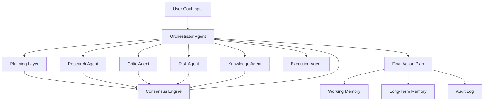
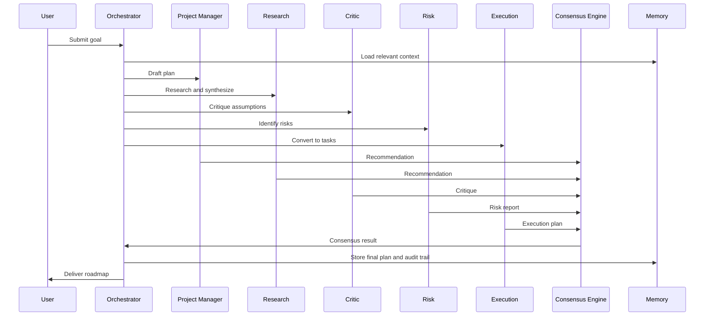
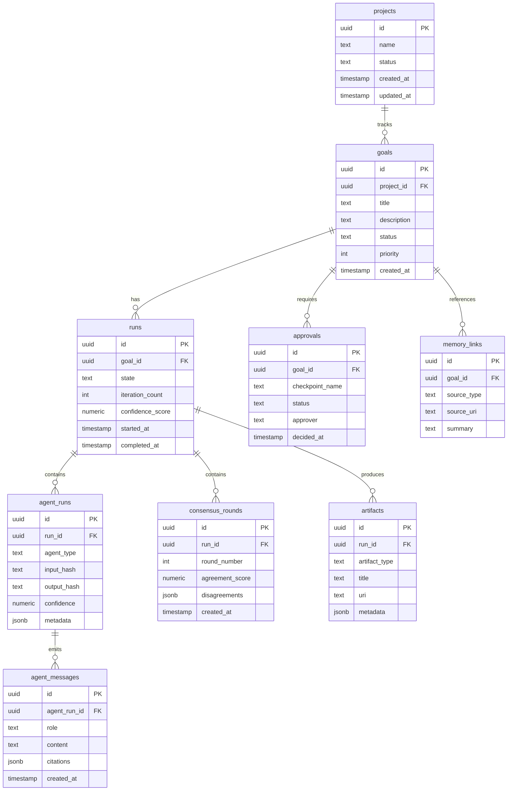

# Personal Operating System (POS) Architecture Proposal

Project: ClassForge / Personal Operating System
Date: 2026-06-04
Status: Architecture + MVP roadmap

## 1. Executive Summary

The Personal Operating System (POS) is a local-first, vendor-agnostic orchestration platform that turns a goal into an execution-ready plan through a controlled multi-agent review loop.

It is designed around four core ideas:

- Separate thinking from execution.
- Make agents specialized, replaceable, and auditable.
- Store working memory and long-term memory separately.
- Optimize for shipped action plans, not open-ended analysis.

The MVP should not attempt full autonomy. It should reliably:

1. Accept a goal.
2. Break it into structured work.
3. Send it through multiple specialist agents.
4. Run critique and revision loops.
5. Produce a final execution plan with confidence scores and audit trail.

## 2. Architecture Principles

- Modular by default.
- Local-first where practical.
- Model-agnostic and provider-agnostic.
- Human approval checkpoints for risky or external actions.
- Full audit trail for all agent outputs and revisions.
- Replaceable storage backends for files, notes, and databases.
- Execution bias over analysis bias.

## 3. System Architecture

### 3.1 High-Level Diagram



### 3.2 Layer Breakdown

#### 1. Agent Framework

The agent framework provides a standard contract for all agents:

- Input schema
- Output schema
- Confidence scoring
- Evidence references
- Revision history
- Tool permissions
- Human-escalation flags

#### 2. Orchestrator Layer

The orchestrator:

- Receives the goal.
- Decomposes it into subtasks.
- Chooses which agents to invoke.
- Orders iterative review cycles.
- Applies iteration limits.
- Produces the final plan.

#### 3. Consensus Engine

The consensus engine:

- Collects all agent recommendations.
- Detects disagreement hotspots.
- Requests revision rounds.
- Computes confidence and agreement scores.
- Stops when convergence or iteration cap is reached.

#### 4. Memory Layer

The memory layer splits into:

- Working memory: ephemeral task state, current run context, draft outputs.
- Long-term memory: durable decisions, project history, reusable knowledge, SOPs, and references.

#### 5. Knowledge Layer

The knowledge layer manages:

- Obsidian notes
- Google Drive documents
- Local files
- GitHub repositories
- Structured database records

#### 6. Execution Layer

The execution layer turns a plan into actionable objects:

- tasks
- milestones
- follow-ups
- documentation items
- review checkpoints
- Codex work items

#### 7. Integration Layer

The integration layer exposes connectors for:

- local filesystem
- Obsidian vault
- Google Drive
- GitHub
- database
- LLM providers

## 4. Data Flow Diagram



## 5. Required Agents

### Orchestrator Agent

Responsibilities:

- Manage the full workflow.
- Select agent order.
- Enforce iteration limits.
- Escalate unresolved conflicts.

### Project Manager Agent

Responsibilities:

- Create roadmaps.
- Define milestones.
- Decompose goals into deliverables.

### Research Agent

Responsibilities:

- Collect source material.
- Summarize findings.
- Surface evidence and citations.

### Critic Agent

Responsibilities:

- Challenge assumptions.
- Find gaps, ambiguity, and overreach.
- Propose alternatives.

### Risk Agent

Responsibilities:

- Identify technical, financial, operational, legal, and delivery risks.
- Estimate likelihood and impact.

### Execution Agent

Responsibilities:

- Convert plans into task lists.
- Map work to implementation steps.
- Produce follow-up actions.

### Knowledge Agent

Responsibilities:

- Maintain memory links.
- Store reusable notes.
- Update decision and SOP references.

## 6. Consensus Engine Design

### 6.1 Loop

1. Agents submit recommendations.
2. Agents review each other’s recommendations.
3. Agents challenge weak points.
4. Recommendations are revised.
5. Confidence scores are assigned.
6. Consensus is calculated.
7. Final recommendation is produced.

### 6.2 Iteration Rules

- Maximum iterations per goal: configurable.
- Maximum revision rounds per agent: configurable.
- Stop early if:
  - confidence exceeds threshold
  - disagreement falls below threshold
  - iteration cap is reached
  - human approval is required

### 6.3 Scoring Model

Recommended output scores per agent:

- confidence: 0.0 to 1.0
- evidence_strength: 0.0 to 1.0
- execution_readiness: 0.0 to 1.0
- risk_level: low / medium / high
- disagreement_index: 0.0 to 1.0

Consensus can be computed using:

- weighted average confidence
- evidence-weighted agreement
- risk penalty on final confidence
- human override when necessary

## 7. Memory Architecture

### 7.1 Working Memory

Stores:

- active goal
- current agent outputs
- iteration state
- temporary evidence
- open questions
- approval checkpoints

Characteristics:

- short-lived
- run-scoped
- easy to reset
- not treated as source of truth

### 7.2 Long-Term Memory

Stores:

- project briefs
- decision logs
- prior plans
- SOPs
- research summaries
- validated artifacts
- reusable prompt templates

Characteristics:

- durable
- indexed
- versioned
- auditable

### 7.3 Memory Sources

Supported sources:

- Obsidian vault
- Google Drive
- local markdown and text files
- GitHub repos and issue history
- structured database records

## 8. Database Schema

### 8.1 Core Entities



### 8.2 Notes

- Use Postgres as the system-of-record database.
- Keep raw documents in file storage or Drive.
- Store only metadata, hashes, links, and structured outputs in the database.

## 9. API Design

### 9.1 Core API Surface

```text
POST   /api/goals
GET    /api/goals/:id
POST   /api/runs
GET    /api/runs/:id
POST   /api/runs/:id/agents
POST   /api/runs/:id/reviews
POST   /api/runs/:id/consensus
POST   /api/runs/:id/finalize
GET    /api/memory/search
POST   /api/memory/ingest
GET    /api/artifacts/:id
POST   /api/approvals
```

### 9.2 Example Payloads

#### Create Goal

```json
{
  "title": "Launch Schedule Builder",
  "description": "Create and validate the MVP execution plan for ClassForge.",
  "priority": 1,
  "projectId": "uuid"
}
```

#### Start Run

```json
{
  "goalId": "uuid",
  "mode": "mvp-consensus",
  "maxIterations": 3
}
```

#### Final Plan Response

```json
{
  "goalId": "uuid",
  "confidenceScore": 0.86,
  "consensusStatus": "approved",
  "risks": [],
  "milestones": [],
  "tasks": [],
  "approvalsRequired": []
}
```

## 10. Repository Structure

Recommended structure for the POS workspace:

```text
schedule-builder/
  src/
    app/
      api/
      goals/
      runs/
      memory/
      approvals/
    components/
    lib/
      agents/
      consensus/
      memory/
      integrations/
      schemas/
      utils/
  docs/
    POS-architecture-and-roadmap.md
    agent-protocol.md
    consensus-engine.md
    memory-model.md
    deployment.md
  public/
  prisma/ or supabase/
  tests/
    unit/
    integration/
    fixtures/
```

## 11. Technology Recommendations

### Frontend / App Layer

- Next.js App Router
- React 19
- Tailwind CSS
- Server actions or route handlers for API edges

### Backend / Data Layer

- Postgres
- Supabase or direct Postgres with a thin adapter
- Object/file storage for large artifacts

### Agent Runtime

- Provider-agnostic LLM adapter
- Typed agent contracts in TypeScript
- Deterministic workflow runner for orchestration

### Memory / Knowledge

- Obsidian for human-readable knowledge
- File system + markdown for local-first content
- Drive connectors for shareable documents
- GitHub connectors for code-linked knowledge

### Observability

- Structured logs
- Run-level audit records
- Hashes for prompts and outputs
- Optional event stream for replay

## 12. MVP Scope

The MVP should include only the minimum features necessary to prove the consensus workflow:

- Create a goal.
- Run the orchestrator.
- Invoke Project Manager, Research, Critic, Risk, and Execution agents.
- Run at least one revision loop.
- Generate a final execution roadmap.
- Save run state and audit trail.

### MVP Non-Goals

- Autonomous external side effects
- Full Google Drive sync
- Full Obsidian bidirectional sync
- GitHub write actions
- Human-in-the-loop scheduling automations
- Complex plugin marketplace

## 13. Implementation Roadmap

### Phase 1: Architecture and Foundation

Deliverables:

- architecture document
- agent protocol spec
- consensus spec
- memory model spec
- initial schema draft
- repository skeleton

Exit criteria:

- the architecture is approved
- the MVP scope is frozen
- the folder structure is committed

### Phase 2: Core Runtime MVP

Deliverables:

- goal intake API
- orchestrator service
- agent interface
- consensus loop
- audit log persistence
- final plan renderer

Exit criteria:

- a goal can complete end-to-end
- all agent outputs are persisted
- final roadmap is generated

### Phase 3: Memory and Knowledge

Deliverables:

- working memory store
- long-term memory index
- local file ingestion
- Obsidian note linking
- Drive link metadata

Exit criteria:

- the system can recall prior decisions and project context
- memory is separated by lifecycle

### Phase 4: Integrations and Hardening

Deliverables:

- Google Drive connector
- GitHub connector
- approval checkpoints
- structured telemetry
- failure recovery and retries

Exit criteria:

- external sources can be referenced safely
- risky operations require approval
- runtime behavior is observable

### Phase 5: Productionization

Deliverables:

- authentication
- deployment strategy
- environment separation
- backups and retention
- test coverage expansion

Exit criteria:

- the system is usable repeatedly without manual cleanup
- audit history is reliable
- the stack can scale to dozens of agents

## 14. Suggested MVP Output Format

For each goal, the system should output:

- goal summary
- scope statement
- assumptions
- risks
- agent-by-agent recommendations
- revision notes
- consensus score
- final roadmap
- task list
- milestones
- approval checkpoints

## 15. Immediate Next Step

Build the MVP runtime in the current Next.js project using:

- typed agent contracts
- a deterministic consensus loop
- a run log persisted to Postgres or Supabase
- a UI or API endpoint that accepts a goal and returns a final action plan

