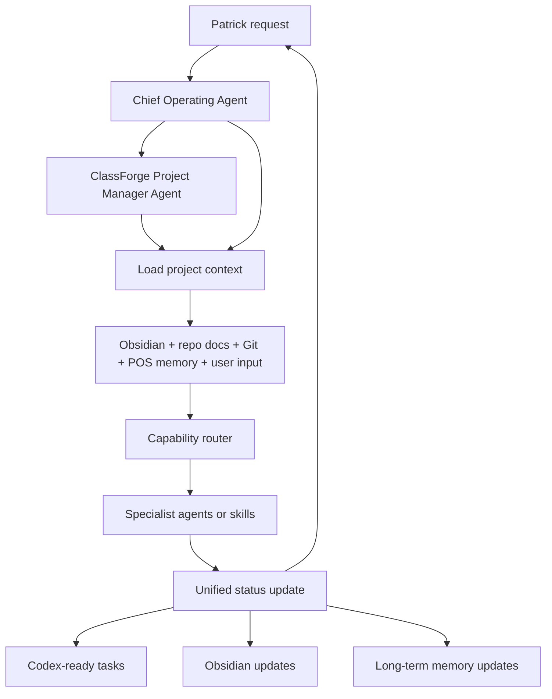

# Chief Operating Agent MVP

Date: 2026-06-06
Pilot: ClassForge / Schedule Builder
Status: working MVP status model and API scaffold

## Executive Summary

The Chief Operating Agent is the central operating layer for the Personal Operating System. It functions as Patrick's AI Chief of Staff and produces a unified status dashboard across projects, blockers, decisions, delegated work, Codex-ready tasks, Obsidian updates, and long-term memory updates.

The Chief Operating Agent does not replace project managers. It owns the cross-project operating view, asks each project manager agent for project-level status, reconciles the outputs against memory and source files, and reports one consolidated answer back to Patrick.

For the pilot, the ClassForge / Schedule Builder Project Manager Agent governs the project day to day: phase, scope, priority, blockers, next actions, and status cadence. The Chief Operating Agent consumes that status and decides what should be escalated, delegated, documented, or sent to Codex next.

For every active project, the standard hierarchy is:

1. Chief Operating Agent
2. Project Manager Agent
3. Applicable specialist agents under the project manager

Default specialist agents under each project manager are Execution, Risk, Knowledge, Critic, and Research. They are used when applicable to the project or task; they are not all activated by default.

Schedule Builder is the pilot because it already contains the POS runtime scaffold:

- deterministic specialist agents
- consensus loop
- final plan generation
- Supabase audit persistence with memory fallback
- owner-gated POS API routes
- Agent Lab compatibility route

## Current ClassForge State

- Product identity: ClassForge and `schedule-builder` are the same project.
- Repo path: the repository root
- App stack: Next.js 15, React 19, Supabase, JavaScript, Tailwind.
- POS runtime scaffold: implemented.
- Public beta: live on Vercel.
- Verified state: the fresh local build renders the current SEO head correctly and the POS runtime passes lint, tests, and production build checks.
- Known next step: keep the public beta under observation and only expand the operating system once a new milestone is explicitly approved.

Recent commits inspected:

- `8cbf0a5` Restrict Agent Lab to owner account
- `ae7acf1` Add public guest mode and POS memory
- `23644a8` Scope POS audit persistence by user
- `bc19d46` Use auth callback for modal Google sign-in
- `65cca31` Trigger Vercel rebuild

## Data Model

The MVP uses a deterministic status payload first, then can persist snapshots later.

```js
export const chiefOperatingStatusUpdate = {
  executiveSummary: '',
  activeProjects: [
    {
      name: '',
      status: '',
      priority: '',
      currentPhase: '',
      nextAction: '',
      blocker: '',
      ownerAgent: '',
      projectManagerAgent: '',
      specialistAgents: [],
      links: [],
    },
  ],
  decisionsNeeded: [],
  delegatedWork: [],
  risksBlockers: [],
  recommendedNextActions: [],
  codexReadyTasks: [],
  obsidianNotesToUpdate: [],
  longTermMemoryUpdates: [],
};
```

Later persistence tables should use `coa_*` names unless Patrick decides to fold status snapshots into the existing `pos_*` audit tables.

## Workflow



## Implemented MVP

- `src/lib/pos/chief-operating-agent.js`
  - Generates the ClassForge / Schedule Builder operating status.
  - Validates required status sections.
  - Includes project links, delegated agents, blockers, decisions, Codex tasks, Obsidian updates, and long-term memory updates.

- `src/app/api/pos/status/route.js`
  - Owner-gated `GET /api/pos/status`.
  - Reuses existing `requirePosOwnerUser`.
  - Loads durable project memory through `loadPosProjectMemory`.

- `tests/unit/pos-runtime.test.js`
  - Verifies the Chief Operating Agent status contract.

## Next Implementation Steps

1. Add persistence tables for status snapshots and delegated work after the status payload is approved.
2. Add optional Calendar/task-manager suggestions, then real write integrations only after approval.
3. Expand the dashboard from the ClassForge pilot into a cross-project operating view once additional project records exist.
